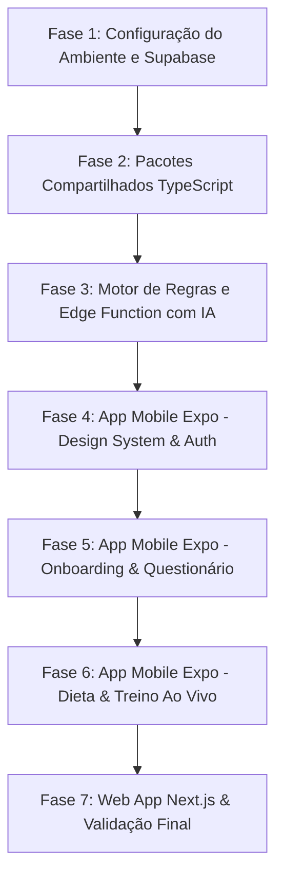

# Planejamento Completo de Implementação Guiado — FitApp

Este plano foi estruturado como um **guia detalhado passo a passo para iniciantes**, explicando não apenas *o que* deve ser feito, mas *como* e *por que* cada etapa é executada.

---

## 1. Visão Geral e Arquitetura do FitApp

O **FitApp** é uma plataforma completa de fitness e nutrição composta por:
1. **App Mobile**: Desenvolvido em React Native + Expo (iOS & Android) com design system ultra-moderno no estilo *Liquid Glass*.
2. **Web App**: Desenvolvido em Next.js 15 para acesso no navegador.
3. **Backend BaaS (Supabase)**: Banco de dados PostgreSQL, Autenticação de Usuários, Realtime e Armazenamento de arquivos.
4. **Motor de Regras + IA (Claude API)**: Cálculo de TMB/TDEE (Mifflin-St Jeor) somado à inteligência artificial para geração de treinos e planos alimentares altamente personalizados.
5. **Base de Alimentos**: Tabela TACO (UNICAMP) integrada com cerca de 600+ alimentos brasileiros.

---

## 2. Visão Geral das Fases de Desenvolvimento



---

## 3. Passo a Passo Completo de Implementação

### FASE 1: Configuração do Ambiente e Banco de Dados Supabase

#### Passo 1.1: Pré-requisitos de Desenvolvimento
1. **Node.js (v18+)**: Certifique-se de ter o Node.js e o npm instalados.
   - Verificar versão: `node -v` e `npm -v`.
2. **Expo Go**: Baixe o aplicativo "Expo Go" na App Store (iOS) ou Google Play (Android) para testar o aplicativo no celular físico.
3. **Supabase CLI**: Ferramenta de linha de comando para gerenciar migrações do banco.
   - Instalação via npm: `npm install -g supabase`

#### Passo 1.2: Instalação das Dependências do Monorepo
No terminal, na raiz do projeto (`/Users/gustavosoares/Documents/Projetos/FitApp`), execute:
```bash
npm install
```
Isso instalará as dependências de todos os workspaces (mobile, web, tipos, utilidades e constantes).

#### Passo 1.3: Configuração do Banco de Dados no Supabase
#### [MODIFY] [001_tabelas_iniciais.sql](file:///Users/gustavosoares/Documents/Projetos/FitApp/supabase/migrations/001_tabelas_iniciais.sql)
Crie as seguintes tabelas no PostgreSQL:
1. `perfis`: Armazena nome, idade, peso, altura, gênero, objetivo, nível de atividade.
2. `questionario_respostas`: Guarda as respostas originais do questionário inicial.
3. `planos`: Plano atual do usuário contendo calorias e metas de macros.
4. `planos_treino`: Divisão de treinos semanais (ex: Treino A, Treino B).
5. `exercicios`: Base de exercícios com grupo muscular, nome, séries, repetições, vídeo/instruções.
6. `sessoes_treino`: Histórico de treinos concluídos pelo usuário com cargas reais registradas.
7. `refeicoes_registradas`: Registro diário de alimentos consumidos, porção em gramas, calorias e macros.
8. `base_alimentos_taco`: Alimentos da tabela TACO (UNICAMP) indexados para busca rápida.

#### Passo 1.4: Políticas de Segurança (Row Level Security - RLS)
#### [NEW] [002_rls_politicas.sql](file:///Users/gustavosoares/Documents/Projetos/FitApp/supabase/migrations/002_rls_politicas.sql)
Garantir que cada usuário só possa ler e alterar seus próprios dados de treino, dieta e perfil:
```sql
ALTER TABLE perfis ENABLE ROW LEVEL SECURITY;
CREATE POLICY "Usuário acessa próprio perfil" ON perfis 
  FOR ALL USING (auth.uid() = id);
```

#### Passo 1.5: Carga da Tabela TACO e Exercícios (Seed)
#### [NEW] [003_seed_alimentos.sql](file:///Users/gustavosoares/Documents/Projetos/FitApp/supabase/migrations/003_seed_alimentos.sql)
Importar os alimentos da tabela TACO em formato JSON (`dados/taco/alimentos.json`) para a tabela `base_alimentos_taco`.

---

### FASE 2: Pacotes Compartilhados (`packages/*`)

#### Passo 2.1: Pacote `@fitapp/tipos`
#### [MODIFY] [index.ts](file:///Users/gustavosoares/Documents/Projetos/FitApp/packages/tipos/src/index.ts)
Definir todas as interfaces TypeScript comuns:
- `Usuario`, `PerfilUsuario`, `RespostaQuestionario`
- `PlanoTreino`, `Exercicio`, `SerieExercicio`, `SessaoTreino`
- `PlanoDieta`, `Refeicao`, `Alimento`, `AlimentoRegistrado`

#### Passo 2.2: Pacote `@fitapp/utilidades`
#### [MODIFY] [calculos.ts](file:///Users/gustavosoares/Documents/Projetos/FitApp/packages/utilidades/src/calculos.ts)
Implementar as fórmulas nutricionais exatas:
1. **TMB (Taxa Metabólica Basal)** via Mifflin-St Jeor:
   - Homens: `(10 * peso) + (6.25 * altura) - (5 * idade) + 5`
   - Mulheres: `(10 * peso) + (6.25 * altura) - (5 * idade) - 161`
2. **TDEE (Gasto Calórico Total)**: `TMB * FatorAtividade`
3. **Calorias-Alvo**: TDEE ajustado conforme o objetivo (+500 para hipertrofia, -500 para emagrecimento).
4. **Macros**:
   - Proteína: 2.0g a 2.2g por kg de peso corporal
   - Gordura: 0.8g a 1.0g por kg de peso corporal
   - Carboidrato: restante das calorias calorias restantes / 4.

#### Passo 2.3: Pacote `@fitapp/constantes`
#### [MODIFY] [index.ts](file:///Users/gustavosoares/Documents/Projetos/FitApp/packages/constantes/src/index.ts)
Exportar enums e listas fixas (Objetivos, Grupos Musculares, Níveis de Atividade, Cores da Marca).

---

### FASE 3: Edge Functions & Geração de Planos via IA (Claude API)

#### Passo 3.1: Criar Edge Function `gerar-plano`
#### [NEW] [index.ts](file:///Users/gustavosoares/Documents/Projetos/FitApp/supabase/functions/gerar-plano/index.ts)
1. Recebe os dados do questionário do usuário.
2. Executa as fórmulas de TMB e macros de `@fitapp/utilidades`.
3. Invoca a **Claude API** (`claude-3-5-sonnet`) com um prompt do tipo JSON Mode, injetando os macros calculados e a lista de exercícios disponíveis.
4. Salva o plano retornado no Supabase (`planos_treino` e `planos_dieta`).
5. Retorna a confirmação para o aplicativo móvel.

---

### FASE 4: Frontend Mobile (React Native + Expo) & Design System Liquid Glass

#### Passo 4.1: Componentes UI de Design System (Liquid Glass)
#### [MODIFY] [CardVidro.tsx](file:///Users/gustavosoares/Documents/Projetos/FitApp/apps/mobile/componentes/ui/CardVidro.tsx)
- Criar container com efeito translúcido usando `expo-blur` (`BlurView`), bordas finas com iluminação sutil (`rgba(255, 255, 255, 0.12)`) e sombra suave roxa.

#### [NEW] [AnelProgresso.tsx](file:///Users/gustavosoares/Documents/Projetos/FitApp/apps/mobile/componentes/ui/AnelProgresso.tsx)
- Gráfico circular com SVG (`react-native-svg`) para exibir calorias consumidas vs meta e divisão de macros em anéis coloridos.

#### Passo 4.2: Autenticação (`apps/mobile/app/(auth)`)
#### [MODIFY] [login.tsx](file:///Users/gustavosoares/Documents/Projetos/FitApp/apps/mobile/app/(auth)/login.tsx)
- Tela de login com campos de e-mail/senha glassmorphism e integração com Supabase Auth (`supabase.auth.signInWithPassword`).

#### Passo 4.3: Onboarding & Questionário Passo a Passo
#### [MODIFY] [index.tsx](file:///Users/gustavosoares/Documents/Projetos/FitApp/apps/mobile/app/questionario/index.tsx)
- Componente de questionário em etapas com barra de progresso no topo:
  - Etapa 1: Idade e Sexo biológico.
  - Etapa 2: Peso atual e Altura.
  - Etapa 3: Objetivo principal (Hipertrofia, Emagrecimento, Definição, Manutenção).
  - Etapa 4: Frequência semanal de treino (2x a 6x).
  - Etapa 5: Restrições alimentares e alergias.
- Ao concluir: envia os dados para a Edge Function `gerar-plano` e redireciona para a tela de resultado.

#### Passo 4.4: Dashboard Inicial (Aba Início)
#### [MODIFY] [inicio.tsx](file:///Users/gustavosoares/Documents/Projetos/FitApp/apps/mobile/app/(tabs)/inicio.tsx)
- Exibe o resumo diário:
  - Anel de Calorias e Macros.
  - Card de "Próximo Treino Agendado" com botão para iniciar.
  - Medidor de consumo de água (copos/ml).
  - Atalhos rápidos: "Registrar Refeição" e "Iniciar Treino".

#### Passo 4.5: Módulo de Dieta & Busca TACO
#### [MODIFY] [dieta.tsx](file:///Users/gustavosoares/Documents/Projetos/FitApp/apps/mobile/app/(tabs)/dieta.tsx)
- Visualização das refeições divididas por horário (Café da Manhã, Almoço, Lanche, Jantar).
- Exibe resumo de macronutrientes do dia (Proteína, Carboidrato, Gordura).

#### [MODIFY] [BuscaAlimentosModal.tsx](file:///Users/gustavosoares/Documents/Projetos/FitApp/apps/mobile/componentes/ui/BuscaAlimentosModal.tsx)
- Modal pesquisável em tempo real que consulta a tabela TACO no Supabase com busca fuzzy.
- Permite ao usuário digitar a porção em gramas e insere o alimento na refeição do dia, recalculando os totais de calorias instantaneamente.

#### Passo 4.6: Módulo de Treino & Treino ao Vivo com Timer
#### [MODIFY] [treino.tsx](file:///Users/gustavosoares/Documents/Projetos/FitApp/apps/mobile/app/(tabs)/treino.tsx)
- Lista dos treinos da semana (ex: Treino A - Peito e Tríceps, Treino B - Costas e Bíceps).

#### [NEW] [index.tsx](file:///Users/gustavosoares/Documents/Projetos/FitApp/apps/mobile/app/treino-ao-vivo/index.tsx)
- Modo de execução interativa do treino:
  - Exibe exercício atual, número da série e carga anterior.
  - Timer regressivo de descanso entre séries com sinalização auditiva/vibratória ao término (`expo-haptics`).
  - Campo de input para registrar a carga efetivamente levantada.
  - Botão "Concluir Treino" salva a sessão no histórico.

---

### FASE 5: App Web (Next.js 15)

#### Passo 5.1: Landing Page e Dashboard Web
#### [NEW] [page.tsx](file:///Users/gustavosoares/Documents/Projetos/FitApp/apps/web/app/page.tsx)
- Landing page moderna apresentando o aplicativo com botões de download e acesso web.
- Dashboard web responsivo replicando as informações do app mobile para uso no desktop.

---

## 4. Plano de Verificação e Testes Passo a Passo

### Teste 1: Autenticação e Criação de Perfil
- **Como testar**: Abrir o aplicativo Expo (`npx expo start`), ir para a tela de registro, cadastrar um usuário com e-mail e senha.
- **Resultado esperado**: O usuário é criado no Supabase Auth e um perfil em branco é inserido na tabela `perfis`.

### Teste 2: Questionário e Geração de Plano por IA
- **Como testar**: Preencher o questionário com dados de teste (Ex: Homem, 28 anos, 80kg, 178cm, Objetivo: Hipertrofia).
- **Resultado esperado**: A Edge Function é acionada, os cálculos de TMB/macros são efetuados e a Claude API retorna a estrutura do treino e da dieta salva no Supabase.

### Teste 3: Registro de Alimentação com Tabela TACO
- **Como testar**: Na aba Dieta, clicar em "Adicionar Alimento", pesquisar "Frango grelhado", informar "150g" e confirmar.
- **Resultado esperado**: O alimento é adicionado à refeição do dia, atualizando o total de proteína e calorias no Anel de Progresso.

### Teste 4: Modo Treino Ao Vivo
- **Como testar**: Iniciar um treino na aba Treino, concluir uma série e disparar o timer de descanso.
- **Resultado esperado**: O timer faz a contagem regressiva de 60s, aciona o haptic feedback ao finalizar e salva a carga registrada no histórico ao concluir o treino.

---

## 5. Perguntas Abertas e Decisões de Arquitetura

> [!IMPORTANT]
> **Convenção de Idioma no Código**: O projeto adota termos em Português do Brasil para variáveis, componentes e pastas (`componentes/`, `servicos/`, `calcularTMB()`). Está tudo certo com essa escolha?

> [!IMPORTANT]
> **Supabase BaaS**: A infraestrutura utiliza Supabase (Autenticação + Banco PostgreSQL + Edge Functions). Essa escolha permite alta produtividade no MVP sem a necessidade de manter servidores dedicados.

> [!NOTE]
> **Uso da Claude API**: A geração inteligente de treinos e planos alimentares exige uma chave de API Anthropic (`ANTHROPIC_API_KEY`) configurada no arquivo de ambiente da Edge Function.
